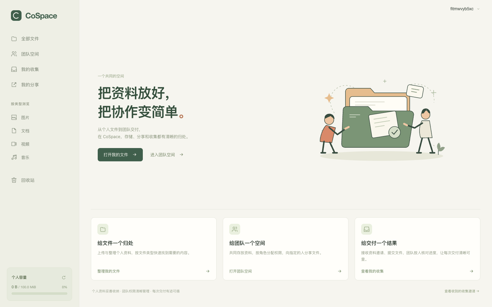
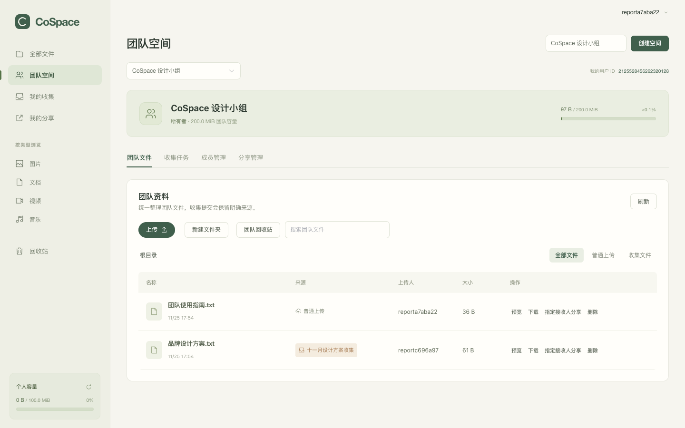
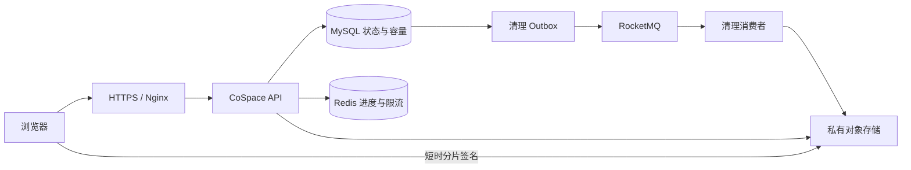

# CoSpace

把资料放好，把协作变简单。

CoSpace 是一个面向个人与小团队的云盘，支持文件存储、团队空间、受控分享和多人文件收集，让资料整理与团队交付更有序。

[](https://github.com/k247216/CoSpace/actions/workflows/verify.yml)
[](LICENSE)

**[在线体验](https://20.205.139.174/)** · [设计文档](docs/README.md) · [部署指南](docs/operations.md)



## 使用流程

1. 注册账号，创建团队空间，添加成员并分配管理员、成员或只读角色。
2. 管理员创建文件收集，选择目标目录、多个提交人、截止时间及文件限制。
3. 受邀者在「我的收集」找到邀请并提交，外部受邀者无需成为整个空间的成员。
4. 管理员查看已交、未交、提交文件与时间；文件列表可区分普通上传和收集来源。
5. 向指定登录用户分享资料，设置到期或撤销；删除文件后经回收站和后台任务清理对象。

| 能力 | 当前实现 |
| --- | --- |
| 文件管理 | 个人目录、团队目录、搜索、移动、回收站、下载与支持格式的预览 |
| 可恢复上传 | 固定任务标识、分片记录、受控并发、续传、取消、幂等完成 |
| 云存储 | 本地存储、OSS 服务端中转、OSS 浏览器分片直传；S3 适配器用于兼容环境联调 |
| 空间治理 | 所有者、管理员、成员、只读；空间边界与操作人分离 |
| 容量控制 | 已用与预占共同约束、事务内结算、取消释放；个人和团队容量条 |
| 文件收集 | 多人邀请、独立提交入口、按人核对、来源筛选、提交快照 |
| 受控分享 | 指定接收人、到期、撤销；下载再次鉴权 |
| 失败恢复 | 上传状态核对、清理 Outbox、消息重投、失败重试与后台兜底 |

<details>
<summary>团队资料与收集报表</summary>




</details>

## 核心设计

**可恢复上传。** 以独立上传任务管理分片和状态流转，使用 Redis Bitmap 记录进度。收尾在事务外完成存储 IO，再通过短事务登记文件、关联引用并结算容量，重复完成返回同一结果。

**容量预占。** 上传初始化预占空间，完成后转为已用容量，取消与过期释放预占。通过容量行锁协调并发申请，个人和团队分别记账，界面展示已用与预占容量。

**异步清理。** 逻辑删除与物理回收分离，业务变更和清理 Outbox 同事务写入。RocketMQ 驱动后台回收，结合消息重投、失败重试与引用复核完成对象清理。

**团队权限。** 工作空间区分资源归属与操作人，提供所有者、管理员、成员和只读角色。上传签发和完成时校验资格，成员移除与文件登记采用一致的加锁顺序。

**文件收集。** 管理员创建收集并批量邀请提交人，接收人在独立入口提交文件。报表按人展示提交状态和文件清单，文件列表支持来源筛选，提交快照保留原始文件名与大小。

**云存储。** 接入私有 OSS Bucket，支持服务端中转和浏览器分片直传，打通上传、续传、下载、取消与回收。通过固定对象键和任务状态核对完成结果，短时签名控制分片上传权限。

## 技术栈

| 层次 | 选型 | 用途 |
| --- | --- | --- |
| 后端 | Java 21、Spring Boot 4.0.10、MyBatis、JDBC | HTTP 接口、数据库映射与需要明确加锁顺序的事务 |
| 数据 | MySQL 8.4、Redis 7.4 | 业务状态和账目；进度缓存、限流与协调 |
| 清理 | RocketMQ 5.3.2 + 数据库 Outbox | 事务外的对象回收及失败恢复 |
| 存储 | 本地文件系统、阿里云 OSS | 保留中转链路，同时支持云端分片直传 |
| 前端 | Vue 3、Vite 8、Element Plus | 资料工作台、收集报表与米白色品牌界面 |
| 部署 | Docker Compose、Nginx、Caddy | 私有服务网络、静态资源与 HTTPS 入口 |



上传字节进度由浏览器事件更新，任务收尾状态通过查询接口同步。

## 本地启动

需要 JDK 21、Maven 3.9+、Node.js 22.12+、Python 3，以及可用的 Docker Compose。建议至少给容器环境分配 4 GiB 内存。启动过程会下载依赖及镜像。

```bash
git clone https://github.com/k247216/CoSpace.git
cd CoSpace
bash scripts/dev-up.sh
```

打开 `http://127.0.0.1:18081`，自行注册测试账号。默认使用容器持久卷中的本地文件系统。脚本生成随机凭证并保存在忽略提交的 `runtime/dev.env`；重复启动复用凭证与数据库卷。需要修改端口时，在首次启动前设置 `COSPACE_DEV_PORT`。

默认演示配置为新个人账户 100 MiB、新团队 200 MiB、单文件上限 100 MiB。

仅开发前端时：

```bash
npm --prefix frontend ci
# 后端直接监听 8080 时使用默认代理
npm --prefix frontend run serve
# 若后端经 Nginx 暴露 /api，则指定完整目标前缀
API_PROXY_TARGET=http://127.0.0.1:18081/api npm --prefix frontend run serve
```

OSS 接入、私有 Bucket、CORS、最小权限、部署与恢复见 [运维说明](docs/operations.md)。

## 测试与测量

```bash
# 快速检查
mvn -f backend/pom.xml -pl r-pan-api-services -am test
npm --prefix frontend run test:upload
npm --prefix frontend run format:check
npm --prefix frontend run build
bash scripts/format-java.sh
```

完整回归需要真实 MySQL、Redis 和独立 RocketMQ，步骤见 [测试说明](docs/testing.md)。GitHub Actions 分别运行快速检查与真实依赖集成检查。

2026-11-25 验证结果：

| 检查 | 结果 |
| --- | --- |
| 后端完整回归 | 212 项通过 |
| 前端上传流程 | 18 项通过 |
| GitHub Actions | 格式与前端、真实依赖集成、空库部署三项通过 |
| 浏览器验收 | 个人文件、团队收集、分享、下载与容量清理 |
| 首页适配 | 六种桌面和移动端尺寸均完整显示 |

目录接口压测使用 Azure 2 vCPU / 8 GiB，应用最大堆 320 MiB，客户端与服务端同机。数据集为 200 条目录项，每档 300 请求，并发 1/4/8/16，前后各三轮，共 7,200 次请求，业务错误为 0。

| 16 并发，三轮中位数 | 调整前 | 调整后 |
| --- | --- | --- |
| 请求吞吐 RPS | 117.00 | 170.15 |
| P95 延迟 | 193.82 ms | 132.19 ms |

调整内容为移除团队列表、搜索和下载鉴权中不必要的排他锁。[测试方法与完整结果](docs/performance.md)

## 代码导航

```text
backend/                     Maven 多模块后端
  r-pan-api-services/        文件、上传、容量、清理与团队业务
  r-pan-api-storage/         本地、OSS、S3 等存储适配器
  r-pan-api-cache/           缓存与 Redis 支持
  r-pan-api-schedule/        后台调度
  r-pan-api-util/            公共工具
frontend/                    Vue 工作台与可恢复上传客户端
deploy/                      应用、HTTPS 入口与集成测试环境
scripts/                     打包、配置生成、回归与有限压测
benchmark/results/           不含凭证的原始聚合指标
docs/                        设计、运维、验证与演示材料
```

## 设计文档

- [可恢复分片上传](docs/resumable-upload-design.md)
- [容量与上传限流](docs/user-space-and-upload-limit.md)
- [异步清理与恢复](docs/reliable-file-cleanup-design.md)
- [团队空间、分享与收集](docs/team-workspace-design.md)
- [部署与排障](docs/operations.md)
- [发布故障记录](docs/failure-cases.md)

## 贡献与许可

修改前请阅读 [贡献约定](CONTRIBUTING.md)。安全问题请按 [安全说明](SECURITY.md) 报告。

采用 [MIT License](LICENSE)；来源与授权说明见 [NOTICE](NOTICE)。
