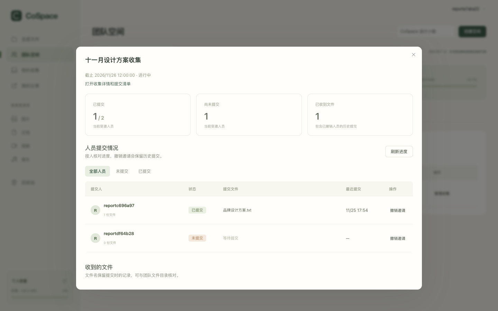
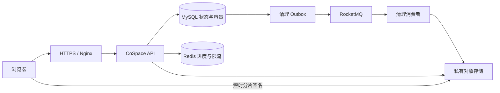

# CoSpace

把资料放好，把协作变简单。

CoSpace 是面向小团队的文件存储与交付系统：个人整理资料，团队按角色共享文件，管理员发起收集并核对谁提交了什么。项目重点是上传、权限、容量与清理在重试和失败时仍能保持一致。

[](https://github.com/k247216/CoSpace/actions/workflows/verify.yml)
[](LICENSE)

> 在线体验入口正在核验公网 HTTPS 可达性。当前演示使用 Azure 部署、阿里云私有 OSS；地址确认可用后在这里公布。请使用测试资料，演示服务不承诺长期保存。


## 一次真实的团队交付

1. 注册账号，创建团队空间，添加成员并分配管理员、成员或只读角色。
2. 管理员创建文件收集，选择目标目录、多个提交人、截止时间及文件限制。
3. 受邀者在「我的收集」找到邀请并提交，外部受邀者无需成为整个空间的成员。
4. 管理员查看已交、未交、提交文件与时间；文件列表可区分普通上传和收集来源。
5. 向指定登录用户分享资料，设置到期或撤销；删除文件后经回收站和后台任务清理对象。

体验两个账号时，使用不同浏览器或独立隐身窗口。普通标签页共享登录 Cookie，页面会阻止陈旧会话继续操作。

| 能力 | 当前实现 |
| --- | --- |
| 文件管理 | 个人目录、团队目录、搜索、移动、回收站、下载与支持格式的预览 |
| 可恢复上传 | 固定任务标识、分片记录、受控并发、续传、取消、幂等完成 |
| 云存储 | 本地存储、OSS 服务端中转、OSS 浏览器分片直传；S3 适配器用于兼容环境联调 |
| 空间治理 | 所有者、管理员、成员、只读；空间边界与操作人分离 |
| 容量控制 | 已用与预占共同约束、事务内结算、取消释放；个人和团队容量条 |
| 文件收集 | 多人邀请、独立提交入口、按人核对、来源筛选、提交快照 |
| 受控分享 | 指定接收人、到期、撤销；下载再次鉴权 |
| 失败恢复 | 上传状态核对、清理 Outbox、消息重投、失败重试与后台兜底 |

<details>
<summary>团队资料与收集报表</summary>




</details>

## 改造重点

**从分片计数升级为任务状态。** 数据库记录上传任务和状态流转，Redis Bitmap 服务于进度查询；重试不会简单累加计数。收尾先持久化意图，在事务外执行存储 IO，再在短事务中登记文件、引用和容量。重复完成返回同一业务结果。

**从同步删除升级为可追踪清理。** 逻辑删除与物理对象回收解耦。清理任务和业务变更同事务写入，后台通过 RocketMQ 投递、重试和复核；对象删除失败能够定位、重试，避免业务行已消失却无法追踪对象。

**从个人文件升级为空间交付。** 文件、任务、预占、分享和收集具有明确的空间归属；操作人仅表示谁执行。上传签发和完成重新校验权限，移除成员与完成登记遵循一致的锁顺序。提交记录保留文件名和大小快照，后续改名或删除不会抹去交付历史。

**从本地联调升级为真实云端验证。** 使用私有 Bucket 验证直传续传、短时签名、完成结果未知、取消回收和鉴权下载；服务器部署包括 HTTPS 入口、受限运行资源、日志、数据库备份与回滚检查。

**从功能验证升级为可复现证据。** 完整隔离回归 212 项通过，前端上传检查 18 项通过；压测保留原始聚合数据、环境和统计口径。团队列表取消不必要的排他锁，写入和权限变更仍保留事务协调。

## 技术与职责

| 层次 | 选型 | 用途 |
| --- | --- | --- |
| 后端 | Java 21、Spring Boot 4.0.10、MyBatis、JDBC | HTTP 接口、数据库映射与需要明确加锁顺序的事务 |
| 数据 | MySQL 8.4、Redis 7.4 | 业务状态和账目；进度缓存、限流与协调 |
| 清理 | RocketMQ 5.3.2 + 数据库 Outbox | 事务外的对象回收及失败恢复 |
| 存储 | 本地文件系统、阿里云 OSS | 保留中转链路，同时支持云端分片直传 |
| 前端 | Vue 3、Vite 8、Element Plus | 资料工作台、收集报表与米白色品牌界面 |
| 部署 | Docker Compose、Nginx、Caddy | 私有服务网络、静态资源与 HTTPS 入口 |



上传字节进度来自浏览器事件，收尾状态通过查询接口确认。当前业务不需要引入 WebSocket。

## 本地启动

需要 JDK 21、Maven 3.9+、Node.js 22.12+、Python 3，以及可用的 Docker Compose。建议至少给容器环境分配 4 GiB 内存。启动过程会下载依赖及镜像。

```bash
git clone https://github.com/k247216/CoSpace.git
cd CoSpace
bash scripts/dev-up.sh
```

打开 `http://127.0.0.1:18081`，自行注册测试账号。默认使用容器持久卷中的本地文件系统，无需 OSS 账号。脚本生成随机凭证并保存在忽略提交的 `runtime/dev.env`；重复启动复用凭证与数据库卷。需要修改端口时，在首次启动前设置 `COSPACE_DEV_PORT`。

默认演示配置为新个人账户 100 MiB、新团队 200 MiB、单文件上限 100 MiB。容量配置不会自动修改已有账户账目。删除容器不会删除命名卷，`docker compose down -v` 会删除对应项目的数据。

仅开发前端时：

```bash
npm --prefix frontend ci
# 后端直接监听 8080 时使用默认代理
npm --prefix frontend run serve
# 若后端经 Nginx 暴露 /api，则指定完整目标前缀
API_PROXY_TARGET=http://127.0.0.1:18081/api npm --prefix frontend run serve
```

OSS 接入、私有 Bucket、CORS、最小权限、部署与恢复见 [运维说明](docs/operations.md)。不要把密钥写入源码或提交 `.env`。

## 测试与测量

```bash
# 快速测试：没有外部依赖时集成测试会显式跳过
mvn -f backend/pom.xml -pl r-pan-api-services -am test
npm --prefix frontend run test:upload
npm --prefix frontend run format:check
npm --prefix frontend run build
bash scripts/format-java.sh
```

完整回归需要真实 MySQL、Redis 和独立 RocketMQ，步骤见 [测试说明](docs/testing.md)。GitHub Actions 分别运行快速检查与真实依赖集成检查。

2026-11-25：212 项完整后端回归零失败、零跳过；快速测试中 66 项集成检查按配置跳过；前端上传 18 项通过，生产 npm 依赖审计未报告已知漏洞。后者仅覆盖当日 npm 生产依赖，不代表整个系统通过安全审计。

压测使用 Azure 2 vCPU / 8 GiB、应用最大堆 320 MiB，与客户端同机；200 条目录项，每档 300 请求，并发 1/4/8/16，前后各三轮，共 7,200 请求，业务错误为 0。16 并发下三轮 RPS 中位数为 117.00 → 170.15，P95 中位数 193.82 → 132.19 ms。低并发并未稳定改善，且存在预热与运行时波动；这些数据不等于公网吞吐、文件带宽或最大承载量。[完整口径与原始结果](docs/performance.md)

## 代码导航

```text
backend/                     Maven 多模块后端
  r-pan-api-services/        文件、上传、容量、清理与团队业务
  r-pan-api-storage/         本地、OSS、S3 等存储适配器
  r-pan-api-cache/           缓存与 Redis 支持
  r-pan-api-schedule/        后台调度
  r-pan-api-util/            公共工具
frontend/                    Vue 工作台与可恢复上传客户端
deploy/                      应用、HTTPS 入口与集成测试环境
scripts/                     打包、配置生成、回归与有限压测
benchmark/results/           不含凭证的原始聚合指标
docs/                        设计、运维、验证与演示材料
```

推荐先读 [上传设计](docs/resumable-upload-design.md) → [容量与限流](docs/user-space-and-upload-limit.md) → [删除恢复](docs/reliable-file-cleanup-design.md) → [团队设计](docs/team-workspace-design.md)。Java 包名、存储类型标识和数据库表名前缀保留兼容性，避免已有文件记录失去正确的存储适配器。显示名称与公开入口统一使用 CoSpace。

## 当前边界

- 当前部署为单应用实例。中转分片保存在实例文件系统；未验证多实例共享分片和故障切换。
- 团队协作指文件管理、受控分享与收集交付；不提供在线文档共同编辑。
- 首版不支持跨空间移动或复制。成员离队后，已入库团队资料保留，未完成任务需要重新核验资格。
- 已开始的鉴权下载不会因中途撤销分享而强行断流；后续请求重新鉴权。
- Bucket 生命周期只兜底未完成分片，不能替代业务对象、引用和容量账目核对。
- 监控、压测和故障注入范围见测试文档；不把测试环境演练描述为大规模生产经验。

## 贡献与许可

修改前请阅读 [贡献约定](CONTRIBUTING.md)。安全问题请按 [安全说明](SECURITY.md) 报告。

采用 [MIT License](LICENSE)；来源与授权说明见 [NOTICE](NOTICE)。
