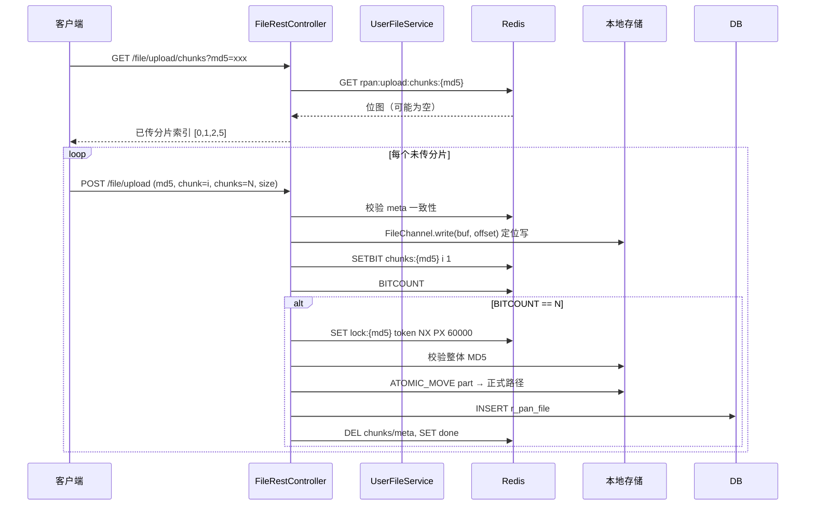

# 文件链路改造设计（v1.0）

> 历史方案：本文保留早期问题分析和候选设计，其中旧 `/file/upload` 及按 MD5 恢复分片的接口不再是当前实现。2026-11-17 已退役旧上传链路；现行协议和实现边界见 [可恢复分片上传设计](resumable-upload-design.md)。

> 用途：改造实施指南 + 面试讲稿 + 简历素材
> 范围：只改「上传 → 秒传 → 下载」链路，不新增业务功能
> 基线：r-pan-scaffolding v4.0（Spring Boot 2.1.9 / JDK 8）
> 原则：每个亮点都必须能回答「原来有什么问题 → 我改了什么 → 结果是多少 → 为什么不用另一种方案」

---

## 0. 总览

| # | 亮点 | 一句话卖点 | 工作量 | 依赖 | 简历关键词 |
|---|---|---|---|---|---|
| L1 | 可靠分片上传 | 分片状态从 JVM 内存迁到 Redis，支持断点续传、多实例、合并幂等 | 4–5 天 | Redis | Redis Bitmap、定位写、分布式锁、幂等 |
| L2 | 秒传安全与性能 | 堵住「知道 MD5 就能拉走别人文件」的越权，并让秒传查询走索引 | 2–3 天 | 无 | 索引优化、越权防护、HSM/内容寻址 |
| L3 | Range 断点续传下载 | 支持 HTTP 206，下载中断可续，零拷贝传输 | 1–2 天 | 无 | HTTP Range、206、transferTo |
| L4 | 工程化与可观测（可选） | 一条命令起环境，链路可追踪，有压测数据 | 2 天 | L1–L3 | Docker Compose、traceId、Micrometer |
| L5 | 文件访问审计（可选） | 异步记录「谁、何时、下载了哪个文件」，不阻塞主链路 | 1–2 天 | L1–L3 | AOP、异步、审计日志 |

**建议实施顺序：L2 → L3 → L1 → L4 →（L5）**。L2/L3 独立、见效快，先拿到手感；L1 是主菜；L4 决定面试官认为这是不是「真项目」。

---

## 1. L1 可靠分片上传

### 1.1 现状（代码证据）

| # | 问题 | 证据 | 后果 |
|---|---|---|---|
| 1 | 分片完成状态存在 JVM 静态 Map | `FileUtil.java:39` `chunkNumContainer` | 重启丢失；多实例各算各的 |
| 2 | 用「计数 == 总分片数」判完成，**重复分片会重复计数** | `FileUtil.java:48-56` `incrementAndGet()` | 客户端重传某一分片 → 计数虚高 → **没传完就合并，文件损坏** |
| 3 | 全局类锁 | `FileUtil.java:133` `public synchronized static` | 所有上传的所有分片串行写，并发度 = 1 |
| 4 | 1KB 写缓冲 | `FileUtil.java:141` | 大文件 IO 次数多，合并慢 |
| 5 | 没有「查询已传分片」接口 | `FileController` 无对应方法 | 断点续传无法实现 |
| 6 | 合并后不校验整体 MD5 | `LocalStorageProcessor.java:57-75` | 坏片也能入库 |
| 7 | 临时文件路径直接拼接客户端文件名 | `FileUtil.java:101-103` + `FileUploadPO.name` 仅 `@NotBlank` | **路径穿越**：`name=../../x` 可写出临时目录 |

> 注：当前实现已经是「单临时文件 + `setLength` 预分配 + `seek` 定位写」，不是「每片一个文件」。改造重点在**状态、并发、幂等、安全**，不在落盘方式。

### 1.2 设计目标

1. 分片状态可跨进程、可重启、可查询 → 断点续传
2. 分片标记幂等：同一片重复上传不改变完成度
3. 合并只有一次（幂等 + 锁），失败可重试
4. 去全局锁，同一文件内分片可并发写
5. 临时文件路径只由服务端可控因子（md5）决定
6. 合并后校验整体 MD5

### 1.3 状态模型（Redis）

| Key | 类型 | 内容 | TTL |
|---|---|---|---|
| `rpan:upload:chunks:{md5}` | Bitmap | 第 i 位 = 第 i 片已到 | 24h |
| `rpan:upload:meta:{md5}` | Hash | `chunks` / `size` / `chunkSize` / `name` / `userId` / `parentId` | 24h |
| `rpan:upload:lock:{md5}` | String（NX PX） | 合并锁，value 为本次 token | 60s |
| `rpan:upload:done:{md5}` | String | 合并完成标记（可选，兜底幂等） | 24h |

为什么用 Bitmap 不用 Set：
- 5000 片时 Bitmap 约 625 B，Set 约 100 KB+；
- `BITCOUNT` 是 O(n/8) 的位运算，不需要搬整个集合；
- 天然幂等：重复置位不改变结果（顺手修掉问题 2）。

为什么状态不放 MySQL：分片写是高频小写入，落库带来写放大和行锁竞争；Redis 的 TTL 正好承担「过期末清理」。

### 1.4 上传时序



### 1.5 关键实现

**① 状态存储（新增组件，不污染现有 `FileUtil`）**

建议放在 `r-pan-api-services/.../modules/file/service/UploadStateStore.java`，通过 `RedisCallback` 直接做位运算，避开 `GenericJackson2JsonRedisSerializer` 的序列化干扰：

```java
@Component
public class UploadStateStore {

    private static final String CHUNK_KEY = "rpan:upload:chunks:";
    private static final String META_KEY  = "rpan:upload:meta:";
    private static final String LOCK_KEY  = "rpan:upload:lock:";
    private static final long TTL_SECONDS = 24 * 3600;

    @Autowired
    @Qualifier("redisTemplate")
    private RedisTemplate<String, Object> redisTemplate;

    /** 置位；返回 true 表示此前已存在（即重复分片） */
    public boolean markChunk(String md5, int index) {
        byte[] key = (CHUNK_KEY + md5).getBytes(StandardCharsets.UTF_8);
        Boolean old = redisTemplate.execute(
                (RedisCallback<Boolean>) conn -> conn.setBit(key, index, true));
        redisTemplate.expire(CHUNK_KEY + md5, TTL_SECONDS, TimeUnit.SECONDS);
        return Boolean.TRUE.equals(old);
    }

    public long countChunks(String md5) {
        Long n = redisTemplate.execute((RedisCallback<Long>) conn ->
                conn.bitCount((CHUNK_KEY + md5).getBytes(StandardCharsets.UTF_8)));
        return n == null ? 0L : n;
    }

    /** 断点续传查询 */
    public List<Integer> uploadedChunks(String md5, int totalChunks) {
        byte[] raw = redisTemplate.execute((RedisCallback<byte[]>) conn ->
                conn.get((CHUNK_KEY + md5).getBytes(StandardCharsets.UTF_8)));
        List<Integer> result = new ArrayList<>();
        if (raw == null) {
            return result;
        }
        for (int i = 0; i < totalChunks && (i >> 3) < raw.length; i++) {
            if ((raw[i >> 3] & (1 << (i & 7))) != 0) {
                result.add(i);
            }
        }
        return result;
    }
}
```

**② 定位写（去掉全局锁）**

`FileChannel.write(ByteBuffer, position)` 是定位写（底层 `pwrite`），**不共享文件指针**，因此同一文件的不同分片可以并发写，且不需要锁：

```java
public static void writeChunk(Path part, long totalSize, long offset,
                              InputStream src, int bufferSize) throws IOException {
    try (RandomAccessFile raf = new RandomAccessFile(part.toFile(), "rw")) {
        if (raf.length() < totalSize) {
            raf.setLength(totalSize);          // 预分配，避免反复扩容
        }
        FileChannel channel = raf.getChannel();
        byte[] buf = new byte[bufferSize];     // 64KB，替代原来的 1KB
        int n;
        long pos = offset;
        while ((n = src.read(buf)) != -1) {
            ByteBuffer bb = ByteBuffer.wrap(buf, 0, n);
            while (bb.hasRemaining()) {
                pos += channel.write(bb, pos);
            }
        }
    }
}
```

要点：
- **不要**再对整方法加 `synchronized`；重叠区间写入才会冲突，而分片下标天然不重叠；
- `setLength` 只做「小于总长才扩展」，避免并发下把已写数据截断；
- 偏移量 = `chunk * chunkSize`，最后一片用 `size - chunk * chunkSize` 计算长度，服务端自己算，不信任客户端。

**③ 合并幂等**

```java
String token = UUID.randomUUID().toString();
if (!stateStore.tryLock(md5, token, 60_000)) {
    return null;                            // 别的请求在合并，本次直接返回
}
try {
    if (stateStore.isDone(md5)) {
        return null;                        // 已完成，幂等返回
    }
    String actualMd5 = DigestUtil.md5(partFile);   // 整体校验
    if (!Objects.equals(md5, actualMd5)) {
        Files.deleteIfExists(partFile);
        stateStore.reset(md5);              // 清位图，让客户端重传
        throw new RPanException("文件校验失败，请重新上传");
    }
    Path target = generateTargetPath(name); // UUID 命名，不拼客户端文件名
    Files.move(partFile, target, StandardCopyOption.ATOMIC_MOVE);
    stateStore.markDone(md5);
    return target.toString();
} finally {
    stateStore.unlock(md5, token);          // Lua 比较 token 再删
}
```

解锁必须用 Lua 比较 token，防止「锁过期后误删别人的锁」：

```lua
if redis.call('get', KEYS[1]) == ARGV[1] then
  return redis.call('del', KEYS[1])
else
  return 0
end
```

**④ 临时文件路径**

```
旧：temp/{客户端文件名}#{md5}
新：temp/{md5}.part
```

只由 md5 决定，客户端无法控制目录；同时新增 `md5` 格式校验（`^[a-fA-F0-9]{32}$`），防止 key 注入和超长 key。

> 注意：路径变更后，`ExpireTempFileCleaner` 的清理逻辑要同步（按后缀 `.part` 清理），否则旧逻辑按 `#` 解析 md5 会失效。

### 1.6 接口变更

| 接口 | 变更 | 说明 |
|---|---|---|
| `GET /file/upload/chunks` | **新增** | 入参 `md5`、`chunks`；返回已传索引 |
| `POST /file/upload` | 分片分支增加 meta 一致性校验 | 同一 md5 但 `size/chunks` 不一致时返回 400 |
| `POST /file/sec-upload` | 见 L2 | — |

```java
@GetMapping("file/upload/chunks")
@NeedLogin
public R<List<Integer>> uploadedChunks(@RequestParam String md5,
                                       @RequestParam Integer chunks) {
    return R.data(iUserFileService.uploadedChunks(md5, chunks, UserIdUtil.get()));
}
```

### 1.7 异常与边界

| 场景 | 处理 |
|---|---|
| Redis 不可用 | 拒绝分片上传，返回可重试错误（不要降级到本地，否则状态不一致） |
| 分片下标越界 / 分片数不匹配 | 400，不写盘 |
| 同一 md5 两个用户同时传 | meta 记录 `userId`，他人直接拒绝（避免互相覆盖） |
| 上传中途放弃 | Redis TTL 24h 自动过期；`.part` 由定时任务清理 |
| 合并时磁盘满 | 保留 `.part`，释放锁，返回 500，客户端可重试（幂等） |
| 合并后 MD5 不符 | 删 `.part`、清位图，返回明确错误码，客户端全量重传 |

### 1.8 验收标准

- [ ] 传 2GB 文件，60% 时 `kill -9`，重启后 `GET /file/upload/chunks` 返回正确索引，续传成功且 MD5 一致
- [ ] 同一分片连续提交 3 次，`BITCOUNT` 仍为 1
- [ ] 10 个不同文件并发上传，吞吐从改造前 X MB/s 提升到 Y MB/s（记录环境）
- [ ] `name=../../evil` 的上传请求无法写出临时目录
- [ ] 两个实例同时部署（`docker compose --scale`），分片与合并均正确

### 1.9 面试讲法

**30 秒版**：
> 原实现把分片完成状态放在 JVM 内存里用计数判断，重启就丢、多实例会算错，而且重复分片会让计数虚高，导致没传完就合并。我把它改成 Redis Bitmap 记录分片位，天然幂等；落盘用 `FileChannel` 定位写替代全局锁；合并前加分布式锁和整体 MD5 校验，并补了「查询已传分片」接口，前端因此能做断点续传。

**追问预演**：

| 问题 | 要点 |
|---|---|
| 为什么用 Bitmap 不用 Set？ | 内存差两个数量级；`BITCOUNT` 位运算；天然幂等 |
| 为什么状态不放 MySQL？ | 高频小写入、写放大、没 TTL |
| 去掉 `synchronized` 为什么安全？ | 定位写不共享文件指针，分片区间不重叠；锁只保护「合并」这个临界区 |
| 锁为什么要 token？ | 防止锁过期后误删他人锁；释放用 Lua 比较 |
| 2GB MD5 校验不慢吗？ | 流式计算约 2–3 秒，可配置开关；也可只对分片抽样校验 |
| 断电/进程崩溃怎么办？ | 状态在 Redis、数据在 `.part`，重启后按位图续传；`.part` 有定时清理兜底 |
| 客户端怎么知道要传哪些片？ | 先调 `/file/upload/chunks`，取差集 |

---

## 2. L2 秒传安全与性能

### 2.1 现状（代码证据）

| # | 问题 | 证据 | 后果 |
|---|---|---|---|
| 1 | 秒传按 MD5 **全局**查物理文件并复用 `realFileId` | `UserFileServiceImpl.java:513` | **知道 MD5 就能把别人的文件「秒传」到自己网盘并下载**（内容越权） |
| 2 | `md5` 列无索引 | `db.sql:8-24`（只有主键） | 每次秒传全表扫描，文件表一大就是慢查询 |
| 3 | 同一 MD5 有多条物理记录时直接放弃 | `UserFileServiceImpl.java:515` `size() > 1` | 秒传命中率随上传次数下降 |
| 4 | 秒传不看 `size` | `FileSecUploadPO` 无 size 字段 | 仅凭 MD5 判定，碰撞/伪造时可能挂错文件 |

### 2.2 方案（分两步，先保守后进阶）

**第一步（必做，1–2 天）**

1. 加索引：
   ```sql
   ALTER TABLE r_pan_file ADD INDEX idx_md5 (md5);
   ```
2. 秒传查询改为「同用户 + 取最新 + 校验 size」：
   ```java
   public boolean secUpload(Long parentId, String filename, String md5,
                            Long size, Long userId) {
       List<RPanFile> list = iFileService.getFileListByMd5(md5);   // 走索引
       RPanFile hit = list.stream()
               .filter(f -> String.valueOf(size).equals(f.getFileSize()))
               .filter(f -> secUploadCrossUser || Objects.equals(f.getCreateUser(), userId))
               .max(Comparator.comparing(RPanFile::getCreateTime))
               .orElse(null);
       if (hit == null) {
           return false;
       }
       saveUserFile(parentId, filename, FolderFlagEnum.NO,
               FileTypeContext.getFileTypeCode(filename), hit.getFileId(), userId,
               hit.getFileSizeDesc());
       return true;
   }
   ```
3. 配置开关（默认关闭跨用户秒传）：
   ```properties
   # 是否允许跨用户秒传。多租户/多人场景建议 false
   rpan.sec-upload.cross-user-enabled=false
   ```
4. `FileSecUploadPO` 增加 `@NotNull Long size`，前端多传一个字段（`spark-md5` 场景下 size 本来就有）。

> 取舍必须能讲：**关掉跨用户秒传，等于牺牲「全网去重」换「不泄露内容」。** 个人网盘可以开，企业/多租户必须关。这就是真实的工程判断。

**第二步（可选，进阶，2–3 天）**

把秒传从「查得到就复用」升级为「内容寻址」：

```sql
ALTER TABLE r_pan_file ADD UNIQUE INDEX uk_md5_size (md5, file_size);
ALTER TABLE r_pan_file ADD COLUMN ref_count INT NOT NULL DEFAULT 1;
```

- 上传时：`INSERT ... ON DUPLICATE KEY UPDATE ref_count = ref_count + 1`，`real_path` 不变；
- 删除时：`ref_count - 1`，归零才删物理文件；
- 收益：同一文件只有一份物理副本，磁盘占用和秒传命中率都变好；
- 代价：要处理历史数据去重、并发扣减、回收站语义。**时间不够就只做第一步，但要知道第二步长什么样**（面试被问「怎么彻底解决」时能答）。

### 2.3 验收标准

- [ ] A 传文件拿 MD5，B 调秒传 → 返回失败（默认配置下）
- [ ] 同一用户重复秒传 → 成功且不产生新物理文件
- [ ] 造 10 万行 `r_pan_file`，`EXPLAIN` 从 `type=ALL` 变为 `type=ref`，秒传 P99 从 X ms 降到 Y ms
- [ ] `size` 不一致时拒绝秒传

### 2.4 面试讲法

**30 秒版**：
> 秒传是按 MD5 全局查物理文件，这带来一个越权问题：只要知道文件 MD5，任何人都能把别人的文件挂到自己名下下载。我加了归属校验和 MD5 索引，并补了 size 校验；同时给出内容寻址 + 引用计数的彻底方案，但评估后没有一次做完，因为历史数据迁移和并发扣减的成本高于收益。

**追问预演**：

| 问题 | 要点 |
|---|---|
| MD5 碰撞怎么办？ | MD5 已可构造碰撞；生产应换 SHA-256，并用 size 做二级校验 |
| 为什么用 `ORDER BY create_time DESC LIMIT 1`？ | 同一 MD5 可能存在多条历史记录，取最新一条保证路径有效 |
| 跨用户秒传真的一点不能开？ | 可以开，但需要「可见性」判定（是否被分享/公开），复杂度高；默认保守 |
| 引用计数怎么保证不超卖？ | 数据库行锁 / `UPDATE ... SET ref_count = ref_count - 1 WHERE ref_count > 0` |
| 为什么不用 Redis 存引用计数？ | 计数器要和文件记录同事务，放 Redis 会有一致性问题 |

---

## 3. L3 Range 断点续传下载

### 3.1 现状

`UserFileServiceImpl.java:632` 的 `doDownload` 直接 `read2OutputStream` 全量输出（`FileUtil.writeFileToStream` 已经是 `transferTo`），**没有解析 `Range` 头**，下载中断只能从头再来。

### 3.2 设计

**请求解析规则**（只支持单段，多段返回 416）：

| 请求头 | start | end |
|---|---|---|
| `bytes=0-1023` | 0 | 1023 |
| `bytes=100-` | 100 | total-1 |
| `bytes=-500` | total-500 | total-1 |
| 无 `Range` | 全量 200 | — |
| 越界 / 非法 / 多段 | 416 | — |

**响应**：

| 场景 | 状态码 | 关键响应头 |
|---|---|---|
| 全量 | 200 | `Accept-Ranges: bytes`、`Content-Length: total` |
| 部分 | 206 | `Content-Range: bytes start-end/total`、`Content-Length: end-start+1` |
| 非法 | 416 | `Content-Range: bytes */total` |

**实现骨架**：

```java
private void doDownload(String filePath, HttpServletResponse response,
                        String filename, String rangeHeader) throws IOException {
    File file = new File(filePath);
    long total = file.length();
    addCommonResponseHeader(response, APPLICATION_OCTET_STREAM);  // 内部有 reset()
    response.setHeader("Accept-Ranges", "bytes");
    // ... Content-Disposition 略

    Range range = Range.parse(rangeHeader, total);   // null 表示无 Range 或不可解析
    if (range == null) {
        response.setContentLengthLong(total);
        transfer(file, 0, total, response);
        return;
    }
    if (!range.isValid()) {
        response.setStatus(416);
        response.setHeader("Content-Range", "bytes */" + total);
        return;
    }
    response.setStatus(206);
    response.setHeader("Content-Range",
            String.format("bytes %d-%d/%d", range.start, range.end, total));
    response.setContentLengthLong(range.length());
    transfer(file, range.start, range.length(), response);
}

private void transfer(File file, long offset, long length,
                      HttpServletResponse response) throws IOException {
    try (FileChannel ch = FileChannel.open(file.toPath(), StandardOpenOption.READ)) {
        ch.transferTo(offset, length, Channels.newChannel(response.getOutputStream()));
    }
}
```

要点：
- `addCommonResponseHeader` 里有 `response.reset()`，**Range 相关头必须在它之后设置**，否则会被清掉；
- `transferTo` 是零拷贝（sendfile），大文件不占用户态内存；
- 先 `setStatus(206)` 再写 body，不要先写流；
- 对 `HEAD` 请求：返回 200 + `Accept-Ranges` + `Content-Length`，不写 body（可选）。

### 3.3 验收标准

- [ ] `curl -H "Range: bytes=0-1023" -o part1` 返回 `206`，`Content-Range: bytes 0-1023/<total>`，文件大小 1024
- [ ] `curl -H "Range: bytes=100-"` 返回剩余全部
- [ ] `curl -H "Range: bytes=-500"` 返回最后 500 字节
- [ ] `Range: bytes=999999999999-` 返回 `416` + `Content-Range: bytes */total`
- [ ] 无 Range 时行为与改造前一致（防止回归）
- [ ] 用 `curl -C -` 或下载器验证中断后续传

### 3.4 面试讲法

**30 秒版**：
> 下载接口原来是一次性全量输出，断网就得重下。我加了 HTTP Range 支持：解析单段区间，返回 206 + `Content-Range`，用 `FileChannel.transferTo` 零拷贝发送，越界返回 416，并补了 `Accept-Ranges` 让客户端知道可以续传。它和分片上传是对称的：一个切着传，一个切着下。

**追问预演**：

| 问题 | 要点 |
|---|---|
| 206 和 200 的区别？ | 206 表示部分内容，必须带 `Content-Range` |
| 为什么不用 `RandomAccessFile`？ | `transferTo` 零拷贝，少一次用户态拷贝 |
| 多段 Range 为什么不支持？ | 需要 `multipart/byteranges`，收益低、实现复杂；明确返回 416 是符合预期的取舍 |
| 并发下载会不会打满带宽？ | 下一步做令牌桶限速（可作为延伸，不必现在做） |
| 断点续传怎么保证文件没变？ | 加 `ETag`（md5）或 `Last-Modified` + `If-Range` |

---

## 4. L4 工程化与可观测（可选，2 天，强烈建议）

### 4.1 Docker Compose

```yaml
services:
  mysql:
    image: mysql:8.0
    environment:
      MYSQL_ROOT_PASSWORD: root
      MYSQL_DATABASE: r_pan
    command: --character-set-server=utf8mb4 --collation-server=utf8mb4_bin
    ports: ["3306:3306"]
    volumes:
      - ./backend/r-pan-api-services/src/main/resources/sql/db.sql:/docker-entrypoint-initdb.d/db.sql
  redis:
    image: redis:7
    ports: ["6379:6379"]
  api:
    build: ./r-pan-api
    depends_on: [mysql, redis]
    ports: ["8080:8080"]
    environment:
      SPRING_DATASOURCE_URL: jdbc:mysql://mysql:3306/r_pan?useUnicode=true&characterEncoding=utf8&serverTimezone=Asia/Shanghai
      SPRING_DATASOURCE_PASSWORD: root
```

配套：`application.properties` 里的密码改成 `${DB_PASSWORD:root}` 这种占位，别再提交明文。

### 4.2 链路追踪

- 新增 `TraceIdFilter`：读 `X-Trace-Id` 或生成 UUID，放进 MDC，`logback-boot.xml` 的 pattern 加 `%X{traceId}`
- 响应头回写 `X-Trace-Id`，方便前端反馈问题时定位
- 接入 `spring-boot-starter-actuator` + `micrometer-registry-prometheus`，暴露 `/actuator/prometheus`

### 4.3 压测

用 JMeter 准备三个场景，每个场景记录：并发数、数据量、机器配置、QPS、P99、错误率。

| 场景 | 变量 |
|---|---|
| 分片上传 | 10 并发 × 100MB 文件 |
| 秒传 | 100 并发，10 万行文件表 |
| Range 下载 | 50 并发 × 500MB 文件 |

**数据必须自己测。** 写「提升了 3 倍」但答不出环境和基线，比不写更糟。

---

## 5. L5 文件访问审计（可选，1–2 天）

### 5.1 表设计

```sql
CREATE TABLE r_pan_file_access_log (
    id           bigint NOT NULL AUTO_INCREMENT,
    user_id      bigint NOT NULL,
    file_id      bigint NOT NULL,
    real_file_id bigint NOT NULL DEFAULT 0,
    action       tinyint NOT NULL COMMENT '1 下载 2 预览 3 分享访问',
    ip           varchar(64) NOT NULL DEFAULT '',
    user_agent   varchar(512) NOT NULL DEFAULT '',
    trace_id     varchar(64) NOT NULL DEFAULT '',
    create_time  datetime NOT NULL DEFAULT CURRENT_TIMESTAMP,
    PRIMARY KEY (id),
    INDEX idx_user_time (user_id, create_time),
    INDEX idx_file_time (file_id, create_time)
);
```

### 5.2 实现要点

- `@AccessLog(action = DOWNLOAD)` 注解 + AOP，切 `download` / `preview`；
- 异步写入：`@Async` 线程池（核心 2、队列 1000、拒绝策略 `CallerRunsPolicy`），或用内存队列 + 批量落库；
- 写失败只记 warn，**绝不能影响下载主链路**；
- 保留策略：定时任务删 90 天前数据（复用 `r-pan-api-schedule`）。

### 5.3 讲法

> 审计不是「记日志」，而是「证明谁在什么时候拿走了什么」。所以我把日志和主链路解耦：AOP 采集、异步落库、失败降级，并用 traceId 和业务日志串起来。

---

## 6. 简历包装

**公式**：

> 场景 + 原来的问题（量化） + 我做了什么（技术名词） + 结果（数字） + 取舍（为什么不用另一种方案）

**示例（数字用你自己的实测值替换）**：

- 重构大文件分片上传链路：将分片完成状态从 JVM 内存迁移至 Redis Bitmap，修复重复分片导致的提前合并问题，支持断点续传与多实例部署；合并耗时由 **X s 降至 Y s**（2GB / 10 并发）。
- 修复秒传越权：原实现按 MD5 全局命中物理文件，存在「知道 MD5 即可获取他人文件」的风险；增加归属校验与 `idx_md5` 索引，秒传查询由全表扫描改为索引命中，P99 **X ms → Y ms**。
- 下载链路支持 HTTP Range（206/416），基于 `FileChannel.transferTo` 零拷贝实现断点续传。
- 引入 Docker Compose 一键启动、traceId 全链路追踪与 JMeter 压测，形成可复现的性能基线。

---

## 7. 实施顺序与分支

```
main
 └─ feat/sec-upload-hardening      (L2, 1–2d)
 └─ feat/download-range            (L3, 1–2d)
 └─ feat/chunk-upload-redis        (L1, 4–5d)
 └─ feat/observability             (L4, 2d)
```

- 每个分支独立可回滚；
- L1 改动面最大，建议最后合，前面先把测试和压测脚本准备好；
- 每完成一个亮点，更新 README 的「改造记录」——面试时直接拿它讲。

## 8. 红线

1. **数据必须真实**。压测数字要能说出机器配置、数据量、并发数。
2. **不要伪造「上线」「用户量」**。面试官一问细节就穿。
3. **不要在简历上写「精通」**，写「实现/修复/优化」。
4. **不要为了炫技引入 Redisson/Kafka**。当前体量用 Redis + 定时任务足够，能讲清「为什么不用」比用了更加分。
5. **改造期间保持主流程可用**，每个改动都有开关或可回滚点。

## 9. 自测清单（面试前逐条打勾）

- [ ] 能用 1 分钟讲清项目整体架构和数据流
- [ ] 能画出分片上传的时序图（不看文档）
- [ ] 能解释 Bitmap 的位运算和内存占用
- [ ] 能解释定位写为什么不需要锁
- [ ] 能解释锁的 token 和 Lua 解锁
- [ ] 能解释秒传越权的攻击路径和修复取舍
- [ ] 能解释 206 的语义和 `Content-Range` 格式
- [ ] 能说出每个改造前后的具体数字
- [ ] 能回答「如果让你重做，哪里会不一样」
- [ ] 能指出当前方案还存在的 2 个不足（诚实是加分项）
