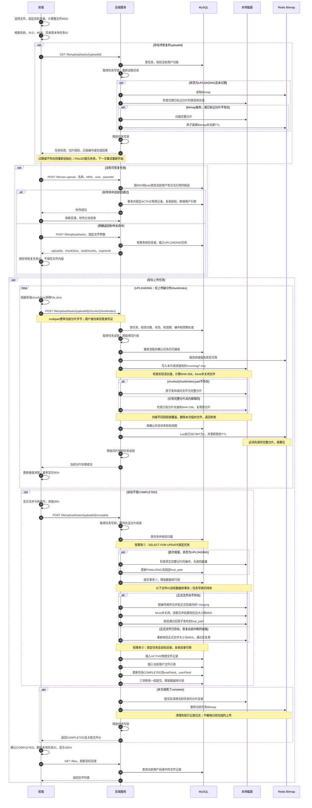

# 可恢复分片上传：接收与收尾实现

2026-11-13。当前完成任务初始化、独立分片接收、进度恢复和合并校验入库；前端已切换到新任务协议；过期和终态任务的后台暂存清理已接入。

## 源码导航（2026-11-17 分包整理）

下面的包均位于 `com.rubin.rpan.modules.file.upload`，只调整职责归类和引用，处理逻辑与接口保持不变。

| 子包 | 类与职责 |
| --- | --- |
| service | UploadTaskService：初始化、receive、status；UploadCompletionService：complete |
| model | UploadTaskInitRequest、UploadTaskView、ChunkReceipt、UploadTaskState：请求、响应与状态 |
| storage | UploadChunkStorage：分片及合并；UploadProgressStore、RedisUploadProgressStore：Bitmap 进度 |
| concurrent | UploadLocks：任务读写锁、同片锁 |
| job | UploadTaskCleaner：过期、废弃、终态任务的上传产物回收 |
| config | UploadProperties、UploadSchedulingConfig：参数与调度开关 |
| limit | UploadInitRateLimiter、Lua及异常响应：仅保护初始化尝试频率 |

阅读主线：`file.controller.UploadTaskController → upload.service → upload.storage`。分析并发时看 `upload.concurrent`；分析遗留产物回收时看 `upload.job`。持久实体 RPanUploadTask 和 Mapper 仍沿用 `file.entity`、`file.dao`。业务文件的 MQ 清理位于独立的 `file.cleanup`，与上传产物回收分别管理。

2026-11-17 后续已接入用户容量账户、初始化幂等重放、取消和初始化限流；新增事务操作及完整入口调用链见 [用户空间与上传初始化限流](user-space-and-upload-limit.md)。本文下方早期验收数量保留为阶段记录，最新验收以新文档为准。

## 1. 已确定的边界

第一版只支持单实例、本地存储；不用Redis分布式锁宣称支持多个独立本地磁盘节点。服务端生成uploadId，固定用户、目录、名称、总大小、标准分片大小、总片数、预期整文件MD5和过期时间。

任务保存在MySQL；完整分片字节在磁盘；Redis Bitmap作为可重建的进度缓存。客户端声明的MD5只作为整文件校验的预期值，不是访问授权，也不是上传任务ID。

方案取舍：

- 保留单临时大文件定位写：少一次合并IO，但重复写、完整性边界与进度恢复更复杂。
- 选择独立完整分片：同一任务按编号保存，能识别完整文件与半成品，Redis丢失后可从磁盘重建；代价是更多文件及后续一次顺序合并IO。

## 2. 数据模型

新增r_pan_upload_task，增量脚本sql/migrations/20261113_upload_task.sql，新库db.sql同步。项目本地库已创建新表，没有修改已有用户文件数据。

关键字段：upload_id、user_id、parent_id、filename、expected_md5、file_size、chunk_size、total_chunks、storage_type、task_state、expires_at。

状态枚举UPLOADING/FINALIZING/COMPLETED/FAILED/EXPIRED。接收阶段写UPLOADING，收尾写FINALIZING，整文件摘要不符写FAILED，业务元数据提交成功写COMPLETED。定时清理器将符合回收条件的任务更新为EXPIRED，并记录artifacts_cleaned_at/artifact_cleanup_error。final_path在进入收尾时记录；real_file_id/user_file_id在完成事务内写入；last_error记录收尾失败。

## 3. 新接口（前端已接入）

所有入口均有NeedLogin，userId从后端上下文取得。

- POST /file/upload/tasks：JSON {name,size,md5,parentId}。校验目标目录及祖先，生成任务；标准分片大小由服务端配置，totalChunks由size推导。不在初始化时写文件或Redis。
- POST /file/upload/tasks/{uploadId}/chunks/{index}：multipart的file字段为当前片。拒绝其他用户任务、非法编号、错误长度、非UPLOADING状态、过期或存储配置变化。
- GET /file/upload/tasks/{uploadId}：返回任务参数、已传编号和allChunksReceived。UPLOADING时全部收齐仍不是COMPLETED；完成后返回关联的realFileId/userFileId，不再访问Redis进度。
- POST /file/upload/tasks/{uploadId}/complete：冻结当前任务，合并、校验并入库；重复调用返回同一任务结果。

空文件采用一个0字节分片。标准大小默认2MiB，最大文件3GiB，总片数最多10000，任务有效期最多24小时。片数先用long计算并检查上限，再转int，防止截断。

## 4. 分片接收顺序

1. 查询任务、校验归属/状态/编号及Multipart实际大小。
2. 取得任务读锁及同片锁，锁后重新读取任务。
3. 先探测Redis；已不可用时拒绝，不降级成JVM计数。
4. 写入incoming/request-随机值.tmp，边读边检查实际字节数，计算服务端SHA-256，force内容并关闭流。
5. 已存在index.part时，检查长度并重新计算已有内容摘要；相同则重复成功，不同拒绝覆盖。
6. 新片使用同一文件系统的ATOMIC_MOVE发布为chunks/index.part；不支持原子移动时失败，不降级发布半成品。
7. 再核对任务仍有效，Lua将Bitmap对应位设为1并设置剩余有效期。
8. 返回该片的编号、长度、摘要与duplicate标记。finally移除本次临时文件。

完整分片没有单独摘要表；重复比较时对已有文件重新计算摘要。进度检查验证完整分片类型和长度；最终完成会计算并验证整文件摘要，不能仅凭进度位图判定内容完整。

## 5. 锁与组件职责

UploadTaskService编排数据库、存储和Redis；UploadChunkStorage只处理文件；RedisUploadProgressStore只处理位图。

UploadLocks为固定数量的JVM条带锁，避免任务越多锁对象无限增长。不同片允许并行，同片互斥；进度重建取得任务写锁，避免清空Bitmap时覆盖并发标记。条带冲突可能额外串行，不宣称无限并发或多实例安全。

receive/status入口拒绝携带外层数据库事务，避免长时间文件IO持有数据库事务。initialize只在短数据库事务中校验并插入任务。

## 6. 位图、恢复与失败窗口

key为rpan:upload:{uploadId}:chunks。使用StringRedisTemplate的原始字节访问和Lua，不经过现有业务缓存JSON值序列化。

Redis位序是每个字节从高位编号，解析使用1 << (7 - (index & 7))；Lua组合SETBIT与PEXPIRE。相关官方说明：[SETBIT](https://redis.io/docs/latest/commands/setbit/)、[位序](https://redis.io/docs/latest/commands/bitfield/#bit-order)。

- 位图不存在：在任务写锁内扫描完整分片，原子重建位图。
- 位图标记存在但文件缺失：重新扫描并修正，不能继续报告缺失分片已完成。
- 完整分片发布后Redis失败：分片保留，返回未确认错误；同片重试会比较内容并补置位。若缓存仍存在但漏记这一片，查询可能报告缺片，客户端重传可修复；本阶段不保证每次状态查询都扫描全部未标记文件。
- .tmp永远不计入进度，模拟进程退出留下半文件不会提前完成。
- 应用重建Service并清空位图后可恢复已有完整分片，但尚未进行真实kill -9/断电演练，也不承诺Redis与文件系统形成跨系统事务。

## 7. 暂存位置与兼容代码

默认使用${rpan.storage.local.root-file-path}/.upload-tasks/{uploadId}/incoming、chunks，与旧temp清理目录隔离，防止旧清理器按目录时间误删新任务。

前端上传按钮使用原生文件选择和File.slice，所有非秒传文件（包括小文件与空文件）都走新任务接口。2026-11-17 已退役旧 POST /file/upload 的普通、分片入口及专属服务方法，移除旧静态分片计数器、定位写入和旧临时目录定时清理器；存储接口及 Local/OSS/FastDFS 实现中的旧 storeWithChunk 同步移除。plupload 依赖及锁文件条目已删除。秒传接口、通用存储读写删除能力及已有文件生命周期继续保留；新的任务上传仍仅支持本地存储。

退役验证：干净构建及94项后端相关测试通过；UploadApiContractTest使用MockMvc、真实服务、H2 Mapper和临时文件系统，确认旧普通/分片请求均无路由（404），新任务初始化、分片、完成及重复完成仍只产生一份新文件和一条新引用。旧业务测试的数据准备改为直接插入测试元数据，不依赖已删除上传方法。前端12项上传编排检查、生产构建及离线npm ci --dry-run锁文件一致性检查通过；本次未重新执行真实浏览器/MySQL验收。

文件名只保存元数据，拒绝目录分隔符/控制字符；实际任务路径完全由服务端UUID和合法编号构造。既有目录和完整分片拒绝符号链接。

## 8. 验证记录

新增28项测试已通过：

- 21项接收与并发测试：任务隔离、乱序、重复、内容冲突、实际流长度、流中断、Redis失败窗口、进度重建、过期、非法目录/路径、空文件、同片并发及不同片并行。
- 1项Spring装配与配置绑定测试，初始化不访问Redis或磁盘。
- 2项独立真实MySQL测试：任务与分片在重新创建Service后可读取、初始化插入后异常可回滚。
- 3项真实Redis测试：高位位序与幂等、Lua重建与过期时间、磁盘与Redis进度恢复。使用DB15随机任务key，只删除测试自己的key，不清库。
- 1项T7项目文件系统测试，验证原子发布与重复识别，不只测试OS临时目录。

原有49项相关回归也通过。两项清理装配测试的bean名称已与当前生产代码Qualifier对齐；未改动其业务语义。

尚未完成真实应用强杀重启、多实例或性能压测。前端已提供失败重试及刷新后重新选择同一文件续传。

## 9. 收尾调用链（已实现）

入口UploadTaskController.complete → UploadCompletionService.complete：

1. 取得任务写锁，等待在途分片接收结束，阻止新片与收尾并行。
2. 短事务锁上传任务行，检查完整分片确实收齐，记录FINALIZING和固定正式路径（root-file-path/uploaded/{uploadId}）。FINALIZING任务可在过期后继续重试收尾；默认连续7天未更新且已过期时才会被后台放弃回收。
3. 无数据库事务执行UploadChunkStorage.assemble：按编号顺序流式合并到正式目录内的.merging临时文件，force并关闭，然后核对实际总长度与整文件MD5，再原子发布。已有正式文件则重新校验并复用。MD5不符时任务FAILED，不插业务记录。
4. 第二段短事务锁上传任务及目标目录，再校验目录仍可用；创建ACTIVE物理记录、当前用户引用，并将任务写COMPLETED与两个ID，三项修改同事务提交。新物理行尚未提交，其他事务无法引用或清理它，无需与旧物理文件争抢引用锁。
5. 提交后清理该任务分片目录与Bitmap；清理失败只记日志，重复complete可再次清理，不撤销已经成功的上传。

收尾IO失败保留FINALIZING并记录错误，可重试。入库失败时物理/引用/完成状态全部回滚，已发布文件仍由任务final_path追踪，下次完成重新校验后入库。重复或同实例并发complete不新增第二份业务记录。

本次验证：79项本地相关测试（含8项新增收尾场景）通过；10项独立真实MySQL测试（8项收尾、2项初始化/恢复）通过。另在T7实际项目卷验证合并发布和已有正式文件复用。MySQL测试库在完成后删除。进程中断用持久状态与故障注入模拟，尚未做真实kill -9演练。

前端协议切换已完成，调用顺序见下一节。已为已知上传任务接入过期和遗留.merging文件清理，见第12节；独立本地磁盘多实例仍不支持。

普通复现：

```bash
mvn -f backend/pom.xml -pl r-pan-api-services -am test \
-Dtest=UploadTaskReceiveTest,UploadTaskWiringTest,UploadCompletionTest,UploadTaskCleanerTest \
-Dsurefire.failIfNoSpecifiedTests=false -Dmaven.test.skip=false
```

真实Redis需显式-Dupload.redis.integration=true，使用本机6379/DB15；密码通过RPAN_TEST_REDIS_PASSWORD环境变量提供。真实MySQL遵循已有隔离r_pan_cleanup_test_*库约束，不提供URL时跳过。T7测试显式传-Dupload.fs.root=项目runtime/upload-fs-check。


## 10. 前端调用链（已接入）

入口：`frontend/src/components/buttons/upload-button/index.vue`。

1. 原生文件选择器接收多个File，以独立队列ID区分同名文件；选择时固定parentId。
2. `utils/resumable-upload.js`计算整文件MD5，先找当前登录会话中保存的未完成任务，避免完成响应丢失后再次秒传创建引用。
3. 没有旧任务时先尝试原有秒传；只有明确的“秒传未命中”才创建上传任务，认证、目录或网络错误会显示失败。
4. 使用任务返回的chunkSize/totalChunks，通过File.slice切片。每个文件最多同时发送3个缺失分片，任一请求成功后补发下一片；所有分片成功后才调用complete。进度汇总已完成分片和各在途请求的进度。任一分片失败后停止派发新片，等待在途请求结束再报错，保留任务供查询后补传。
5. 失败后按钮保留，点重试先GET任务状态，跳过已经收到的分片。刷新后本地文件内容无法自动恢复，需要重新选择同一文件、重新计算MD5，再根据文件名/MD5/大小/目录匹配保存的uploadId。任务ID按登录会话隔离保存在localStorage，不保存文件内容或登录凭证；浏览器禁用存储时仍可在当前页面内重试。
6. 分片收到进度最多95%；调用complete时显示“合并与校验中”。仅COMPLETED显示100%和成功，并刷新目录；FINALIZING直接重试完成；已COMPLETED仅确认结果，不再上传或秒传。
7. 完成后删除本地任务记录。FAILED显示具体原因并清除旧任务关联，下一次重试重新开始；已过期或不存在的任务重新初始化。

`api/upload.js`封装四个新任务接口与原有秒传。通用http拦截器识别FormData，避免JSON.stringify吞掉分片；multipart边界交给浏览器生成。网络错误保持Promise拒绝，不会被当成上传成功。

验证：`cd frontend && npm run test:upload`，9项协议编排测试通过；`NODE_OPTIONS=--openssl-legacy-provider npm run build`通过（现有包体积告警）。真实浏览器连接本机Spring Boot/MySQL/Redis，使用本次独立测试账号验证：第2片失败后点击重试、刷新后重新选择并补传缺片、正确multipart边界、未调用旧/file/upload、完成后目录刷新。两份约5MiB/4MiB文件的磁盘SHA-256与原文件一致，各只有一条用户引用，任务均COMPLETED。本次临时测试账号与数据在验证后删除。

证据保存在`output/playwright/resumable-upload.png`和`output/playwright/upload-verification.json`。目前没有自动恢复浏览器本地文件访问权限或后台上传；刷新后须用户重新选择文件。

2026-11-17 前端改为每个文件最多3片并发。`npm run test:upload`的12项测试通过，新增覆盖并发上限、乱序响应、等待所有分片后合并、失败停止派发并等待在途请求、重试补片及进度汇总。本次并发改动尚未进行真实浏览器联调。


## 11. 完整上传时序图

以下对应当前代码：单实例本地存储，前端每个文件最多3片并发；服务端支持同片幂等和不同片并发。图中的分片循环展示单片处理步骤，实际不同编号的请求可交错执行；全部成功后才进入合并。图展示成功主线，失败窗口见表。



补充边界：

- 图中分片成功发布与Bitmap置位之间没有跨系统事务；Redis标记失败时完整分片保留，客户端收到失败后可重传并补标记。
- Bitmap仍存在但漏记某片时，当前实现不保证状态查询自动找出所有漏记文件；重传该片会比较已有内容并补标记。
- 如果查询任务已经COMPLETED，前端直接确认成功、刷新目录，不再调用秒传或complete。若只是完成响应丢失，沿原uploadId查询即可恢复结果。
- 图中JVM任务锁、同片锁都只协调本实例；数据库行锁只在各自事务提交或回滚时释放。

| 中断或失败位置 | 留下的结果 | 后续处理 |
| --- | --- | --- |
| 分片尚未完整发布 | 本次临时文件可能残留，没有完成标记 | 重新上传；临时文件不计入进度 |
| 完整分片已发布，Bitmap尚未置位 | 磁盘有完整分片，进度可能少记 | 同片重传核对内容并补置位；Bitmap缺失时扫描重建 |
| 进入FINALIZING后，合并未完成 | 任务记录了正式路径，可能存在.merging文件 | 再次complete重新合并；超过收尾恢复窗口后由后台标记EXPIRED并清理 |
| 整文件大小或MD5不符 | 任务FAILED，不创建业务文件记录 | 前端提示失败，下一次重试创建新任务 |
| 正式文件已发布，入库失败 | 业务表与COMPLETED修改一起回滚，任务仍FINALIZING | 再次complete校验并复用正式文件后入库 |
| 入库成功，响应丢失 | 数据库任务已经COMPLETED | 查询原任务确认结果，不再创建用户引用 |
| 入库成功，分片或Bitmap清理失败 | 上传仍成功，中间数据可能残留 | 日志记录；重复complete可再清理，后台扫描终态任务兜底清理 |


## 12. 过期和废弃任务的后台清理（已实现）

入口：`UploadTaskCleaner.sweep`，默认启动60秒后开始，每60秒扫描一批，最多50条。独立于已接入RocketMQ的业务文件清理链路；这里回收上传过程中的中间数据，不借用用户引用删除流程。

回收规则：

| 任务状态 | 条件 | 清理内容 |
| --- | --- | --- |
| UPLOADING | expires_at已到期 | 先转EXPIRED，再清理任务目录、残留合并临时文件和Bitmap |
| FINALIZING | 已过期，且updated_at距现在至少7天 | 先转EXPIRED；清理上述中间数据，以及已发布但尚未入业务表的正式文件 |
| FAILED / EXPIRED | 尚未登记清理完成 | 清理中间数据与没有物理元数据的正式文件 |
| COMPLETED | 尚未登记清理完成 | 只清理分片、合并临时文件和Bitmap，保留正式文件及业务记录 |

这里7天指收尾任务连续未更新的恢复窗口，不是文件创建后7天必删。收尾失败会更新任务时间；活跃收尾过程还受任务写锁保护。已知任务被回收后保留任务行，不做物理删除，便于前端识别EXPIRED和排查。

实际顺序：

定时扫描候选任务
↓
尝试取得与接收、合并共用的任务写锁；取不到就跳过本轮
↓
短事务SELECT FOR UPDATE锁定任务，重新判断状态、期限和是否已清理
↓
需要放弃的UPLOADING/FINALIZING转EXPIRED并提交；终态保持原状态
↓
事务外校验路径并检查废弃正式文件是否已有物理元数据
↓
删除该uploadId的任务目录、该UUID前缀的.merging文件；废弃且未入库的正式文件也删除
↓
删除Bitmap
↓
短事务登记artifacts_cleaned_at，清空artifact_cleanup_error
↓
释放任务写锁

磁盘或Redis失败时不登记清理完成，独立写artifact_cleanup_error；保留原上传last_error。下一轮再扫描，已经不存在的文件按成功处理。进程在EXPIRED提交后退出或在删除后、登记成功前退出，都会留下可继续扫描的记录。

路径由配置的root-file-path和服务端UUID推导，final_path仅用于一致性复核。只处理已知任务的目录和该UUID的合并临时文件；不按文件年龄清扫整个上传根目录，不跟随目录符号链接。废弃正式文件若已有r_pan_file记录，停止该任务清理并记录异常，保留给排查；COMPLETED正式文件始终留给既有业务文件生命周期管理。

新增迁移：`sql/migrations/20261114_upload_artifact_cleanup.sql`。增加artifacts_cleaned_at、artifact_cleanup_error和idx_upload_artifact_gc；已在本地应用库增量执行，没有删除业务记录。新建库的db.sql也同步。

配置：

```properties
rpan.upload.gc.enabled=true
rpan.upload.gc.initial-delay-ms=60000
rpan.upload.gc.scan-delay-ms=60000
rpan.upload.gc.batch-size=50
rpan.upload.gc.finalizing-retention-ms=604800000
```

验证：93项本地相关测试通过，包含13项清理场景及独立调度启停装配；23项独立真实MySQL测试通过（13项清理、8项完成、2项初始化/恢复），临时测试库已删除。覆盖过期、收尾恢复窗口、完成文件保护、元数据保护、磁盘/Redis失败重试、过期事务回滚、在途读写锁跳过、路径与符号链接、批次限制。存储删除时还断言当前没有数据库事务且EXPIRED已提交。

当前仍限定单实例本地存储；不自动删除没有数据库任务记录的未知目录，任务历史记录也不自动清表。真实kill -9/断电演练和性能压测尚未进行。

